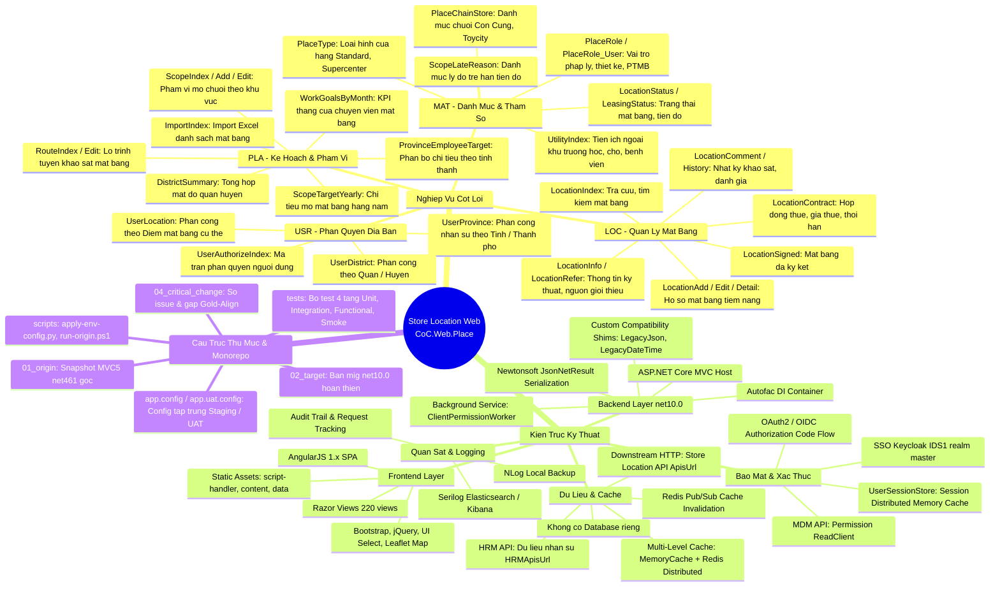
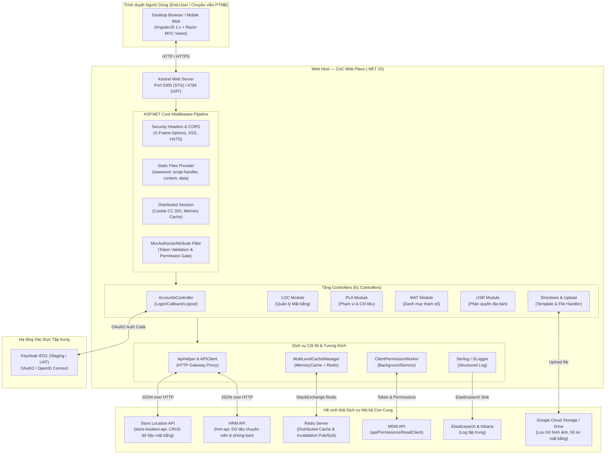
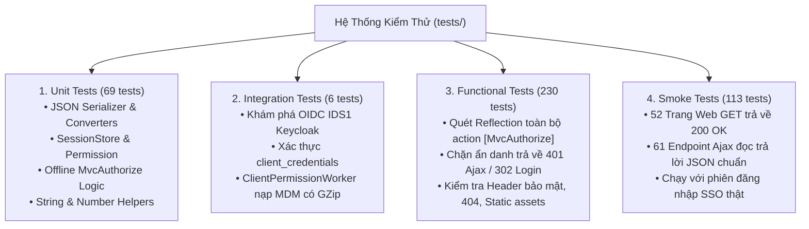

# Sơ Đồ Tư Duy & Tổng Quan Kiến Trúc — `cci-store-location-web` (CoC.Web.Place)

> **Dự án**: `cci-store-location-web` (Tên mã: `CoC.Web.Place` / `store-location-web`)  
> **Thư mục mã nguồn**: [`cci-store-location-web/`](file:///e:/Work/Place_Migrate/cci-store-location-web)  
> **Tổ chức**: Hệ thống Bán lẻ Con Cung (Nhóm: `4_STORE-LOCATION`)  
> **Mục đích**: Cổng thông tin & Web App Quản lý Mặt bằng, Khảo sát, Đàm phán và Lập kế hoạch Phát triển Chuỗi Cửa hàng Con Cung trên toàn quốc.  
> **Hiện trạng**: Đã hoàn tất nâng cấp từ **ASP.NET MVC 5 (.NET Framework 4.6.1)** sang **ASP.NET Core (.NET 10)**.

---

## 1. Sơ Đồ Tư Duy Tổng Thể (System Mindmap)



---

## 2. Sơ Đồ Kiến Trúc Hệ Thống (Architecture & Data Flow)



---

## 3. Bản Đồ Phân Hệ Nghiệp Vụ (Business Domain Matrix)

Hệ thống được tổ chức nhất quán theo **4 phân hệ nghiệp vụ chính**, xuyên suốt từ Frontend (`script-handler/`), Controllers, Request/Response DTO cho đến `ObjectCore`:

| Phân hệ | Tên Đầy Đủ | Nhiệm Vụ Nghiệp Vụ Chính | Các Controller Tiêu Biểu |
|---|---|---|---|
| **LOC** | **Location Management**<br/>(Quản lý Mặt bằng) | Quản lý vòng đời mặt bằng: tìm kiếm, thẩm định kỹ thuật, đàm phán giá thuê, ký hợp đồng, lưu trữ lịch sử khảo sát và đánh giá thực địa. | `LocationIndex`, `LocationAdd`, `LocationEdit`, `LocationDetail`, `LocationContract`, `LocationComment`, `LocationHistory`, `LocationInfo`, `LocationSigned` |
| **PLA** | **Planning & Scope**<br/>(Kế hoạch & Phạm vi) | Lập kế hoạch mở rộng chuỗi cửa hàng, quản lý phạm vi mở mới (Scope), giao chỉ tiêu KPI mở điểm từng tháng cho nhân viên, quản lý lộ trình khảo sát và import Excel hàng loạt. | `ScopeIndex`, `ScopeAdd`, `ScopeEdit`, `ScopeTargetYearly`, `WorkGoalsByMonth`, `ProvinceEmployeeTarget`, `RouteIndex`, `DistrictSummary`, `ImportIndex` |
| **MAT** | **Master Data**<br/>(Danh mục & Tham số) | Quản lý toàn bộ danh mục metadata hỗ trợ vận hành: trạng thái mặt bằng, loại hình cửa hàng (Standard/Supercenter), xếp hạng quy mô, lý do trễ hạn mở điểm, danh mục tiện ích xung quanh. | `LocationStatusIndex`, `LocationTypeIndex`, `PlaceChainStoreIndex`, `PlaceTypeIndex`, `PlaceRoleController`, `ScopeLateReasonController`, `UtilityIndex` |
| **USR** | **User & Territory**<br/>(Phân quyền Địa bàn) | Ma trận phân quyền kiểm soát dữ liệu theo khu vực địa lý: gán chuyên viên phụ trách theo Tỉnh/Thành phố, Quận/Huyện hoặc địa điểm cụ thể. | `UserAuthorizeIndex`, `UserProvince`, `UserDistrict`, `UserLocation` |

---

## 4. Kiến Trúc Migration (.NET Framework 4.6.1 sang .NET 10)

### 4.1 Bố cục Monorepo / Migration Layout
- `01_origin/`: Snapshot nguyên bản từ repo cũ (`coc.web.place.git` branch `master10`, commit `d1299579`). Dùng làm bản đối chiếu chuẩn (Pristine baseline), không chỉnh sửa trực tiếp.
- `02_target/`: Dự án đích chạy trên **ASP.NET Core .NET 10** theo phương pháp **Keep-Structure**:
  - Giữ nguyên cấu trúc thư mục, tên file, namespace gốc (`CoC.Web.Place`).
  - Toàn bộ khối code thay đổi đều được gắn tag tường minh: `//AI[MIGRATE_START]` ... `//AI[MIGRATE_END]`.
  - Giữ lại các file không còn biên dịch dưới dạng `<Compile Remove>` thay vì xóa vật lý khỏi đĩa (quy tắc *Exclude, don't delete*).

### 4.2 Tiến trình Gold-Alignment Mới Nhất
Theo hồ sơ [`04_critical_change/03_gold_align_cci_core_mvc.md`](file:///e:/Work/Place_Migrate/cci-store-location-web/04_critical_change/03_gold_align_cci_core_mvc.md):
1. **Chuyển đổi thư viện nền tảng**: Thay thế các DLL proprietary cũ (`Core.MVC`, `Core.Cache`, `Core.DTO`, `Core.Log`) bằng bộ NuGet chuẩn nội bộ:
   - `CCI.Core.MVC` (1.0.60)
   - `CCI.Core.ClientHelper` (1.0.4)
   - Giữ lại qua HintPath các DLL không có package thay thế: `Core.Helper.dll`, `Core.Infrastructure.dll`, `Libs.dll`, `LinqToExcel.dll`, `Remotion.Data.Linq.dll`, `SM.ItemCore.dll`.
2. **Cấu hình chuẩn hóa (Dual-Configuration)**:
   - `appsettings.json`: Cấu hình phẳng `AppSettings` phục vụ `AppConfig.Instance`.
   - `cci.core.json`: Cấu hình hệ thống chuẩn cho JWT, Redis, Serilog, Session.
   - Nạp lifecycle hooks `HostBuilderItem` (`ConfigurationItem`, `ServiceCollectonItem`, `ContainerBuilderItem`, `ApplicationBuilderItem`).
3. **Cơ chế xác thực**:
   - Tích hợp IdentityServer 1 (Keycloak `master` realm) qua giao thức Authorization Code không PKCE.
   - Lưu session an toàn qua `UserSessionStore` (Cookie `CC.SID` SameSite=Lax).
   - Tự động nạp bảng phân quyền người dùng qua background service `ClientPermissionWorker`.

---

## 5. Chiến Lược Cấu Hình & Môi Trường

Hệ thống sử dụng cơ chế **Cấu hình tập trung một nguồn sự thật (Single Source of Truth)**:
- Nguồn Staging: [`app.config`](file:///e:/Work/Place_Migrate/cci-store-location-web/app.config) (Target port: **5305**, Origin port: **4205**)
- Nguồn UAT: [`app.uat.config`](file:///e:/Work/Place_Migrate/cci-store-location-web/app.uat.config) (Target port: **4784**, Origin port: **4205**)
- Công cụ nạp cấu hình: `scripts/apply-env-config.py` tự động chuyển đổi XML thành:
  - `01_origin/CoC.Web.Place/appSetting.config`
  - `01_origin/CoC.Web.Place/Web.config`
  - `02_target/CoC.Web.Place/appsettings.json`

> [!WARNING]
> Tuyệt đối không sửa tay trực tiếp vào `appsettings.json` hay `appSetting.config` vì lệnh `make config` sẽ ghi đè từ file pristine gốc.

---

## 6. Chiến Lược Kiểm Thử (4-Track Test Suite)

Thư mục `tests/` chứa bộ kiểm thử tự động toàn diện gồm 4 tầng, với **418 bài kiểm tra** đã chạy pass 100%:



---

## 7. Các Lệnh Điều Hành Chính (Cheat-sheet)

```bash
# Bơm cấu hình môi trường Staging (mặc định)
make config

# Chuyển đổi môi trường sang UAT
make config ENV=uat

# Khôi phục cấu hình sạch ban đầu
make config ARGS="--restore"

# Biên dịch và kiểm tra trạng thái target (.NET 10)
make -C 02_target build

# Chạy ứng dụng local (.NET 10 Kestrel)
make -C 02_target run

# Chạy xác minh khởi động (Health check cổng 5305/4784)
make -C 02_target verify

# Chạy toàn bộ 4 tầng test suite
make config ENV=uat && make -C 02_target test && make config
```

---

## 8. Ghi Chú Kỹ Thuật Đã Xử Lý (Resolved Technical Items)

> [!TIP]
> **Đã xử lý cảnh báo NU1605 (Package Downgrade)**:
> - Đã nâng cấp `EPPlus` từ `5.7.3` lên **`7.2.2`** trong `02_target/CoC.Web.Place/CoC.Web.Place.csproj` để đồng bộ hoàn toàn với transitive dependency của `CCI.Core.Utilities 1.0.5` (thuộc bộ `CCI.Core.MVC 1.0.60`).
> - Kết quả: `dotnet restore` và `dotnet build` đạt **0 Error(s)** hoàn tất.

