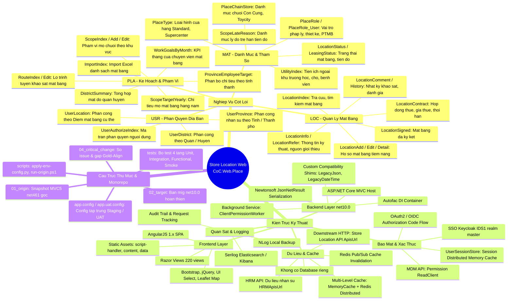
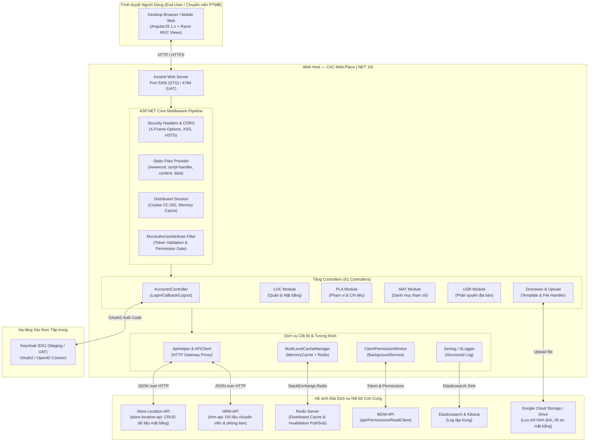

# Đánh Giá Tổng Thể, Kiến Trúc & Sơ Đồ Tư Duy Dự Án `cci-store-location-web`

## 1. Thông Tin Chung
- **Dự án**: `cci-store-location-web` (`CoC.Web.Place`)
- **Repo Git**: `https://tinhkun102@bitbucket.org/concung/cci-store-location-web.git`
- **Vị trí lưu trữ**: [`e:\Work\Place_Migrate\cci-store-location-web`](file:///e:/Work/Place_Migrate/cci-store-location-web)
- **Nhóm chức năng**: Quản lý mặt bằng, điểm thuê và mở rộng chuỗi cửa hàng Con Cung (Group: `4_STORE-LOCATION`).
- **Nền tảng**: Đã được migrate từ **ASP.NET MVC 5 (.NET 4.6.1)** sang **ASP.NET Core (.NET 10)**.

---

## 2. Sơ Đồ Tư Duy (Mindmap)

---

## 3. Kiến Trúc Luồng Dữ Liệu (Data Flow)

---

## 4. Chi Tiết Các Tầng Công Nghệ & Thành Phần

### 4.1 Frontend Layer
- **Framework**: AngularJS 1.x kết hợp MVC Razor Views (220 file `.cshtml`).
- **Tài nguyên tĩnh**: Nằm trong `wwwroot/` với 3 thư mục `script-handler/`, `content/`, `data/`.
- **Thư viện UI**: Bootstrap, jQuery, Angular UI-Select, Leaflet Map (bản đồ trực quan hóa vị trí cửa hàng và mật độ dân cư).
- **Format dữ liệu**: JSON serialization kiểu PascalCase tương thích với client AngularJS ban đầu.

### 4.2 Backend & Web Host (.NET 10)
- **Host**: Kestrel chạy trên `net10.0` với cấu hình SDK Web (`Microsoft.NET.Sdk.Web`).
- **DI Engine**: Autofac `8.3.0` tích hợp sâu qua `AutofacServiceProviderFactory`.
- **Cơ chế Adapter/Shims**:
  - `LegacyDateTimeJsonConverter` & `LegacyTimeSpanJsonConverter`: Xử lý định dạng ngày tháng kiểu cũ `/Date(ms)/` và ISO.
  - `LegacyJsonNetResult` / `BaseController`: Đảm bảo serialization chuẩn `Newtonsoft.Json` mà không làm thay đổi các model cũ.
  - `LegacyHosting`: Giả lập `Server.MapPath` và `HttpRuntime.AppDomainAppPath` thông qua `IWebHostEnvironment.ContentRootPath`.

### 4.3 Xác thực & Ủy quyền (AuthN / AuthZ)
- **SSO Keycloak (IDS1)**: Sử dụng OAuth2 Authorization Code flow (không dùng PKCE, `response_mode=query`).
- **Session**: Session được lưu qua `AddDistributedMemoryCache` với cookie `CC.SID` (`SameSite=Lax`).
- **MDM Permission**: Dịch vụ nền `ClientPermissionWorker` tự động fetch bảng phân quyền từ `MDMUrl/api/Permissions/ReadClient` lúc khởi động và định kỳ.
- **Filter**: `MvcAuthorizeAttribute` kiểm tra quyền theo module và hành động.

### 4.4 Tích hợp Dữ liệu & Caching
- **Không có Database kết nối trực tiếp**: Mọi truy vấn dữ liệu đều thực hiện qua HTTP REST calls đến downstream API `store-location-api` (`ApisUrl`).
- **Multi-Level Cache**:
  - Tầng 1: In-Memory Cache cục bộ (`MemoryCacheManager`).
  - Tầng 2: Distributed Cache qua Redis (`RedisCacheManager`).
  - Đồng bộ Cache: Cơ chế Pub/Sub qua Redis channel (`SubcribeMessageFromRedisSafe`).

---

## 5. Phát Hiện Kỹ Thuật Đáng Lưu Ý (Technical Observation)

> [!NOTE]
> **Cảnh báo NU1605 (Package Downgrade)**:
> Khi chạy `dotnet restore` trên `02_target/CoC.Web.Place.sln`, hệ thống phát hiện lỗi:
> `error NU1605: Warning As Error: Detected package downgrade: EPPlus from 7.2.2 to 5.7.3.`
> **Nguyên nhân**: Bản nâng cấp `CCI.Core.MVC 1.0.60` kéo theo `CCI.Core.Utilities 1.0.5`, gói này phụ thuộc vào `EPPlus >= 7.2.2`. Trong khi đó, `CoC.Web.Place.csproj` vẫn đang ghim cứng `<PackageReference Include="EPPlus" Version="5.7.3" />`.
> **Hướng xử lý đề xuất**: Nâng version EPPlus trong `CoC.Web.Place.csproj` lên `7.2.2` hoặc thêm cấu hình NoWarn thích hợp.
